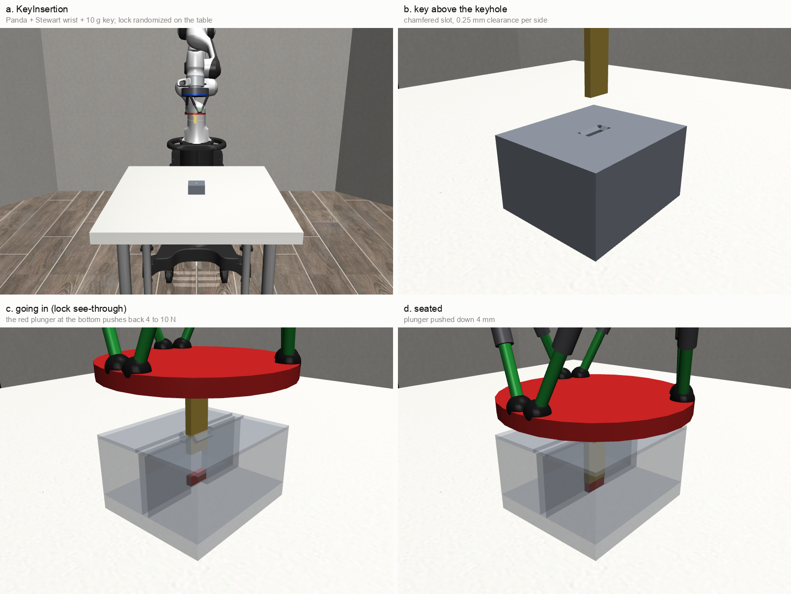
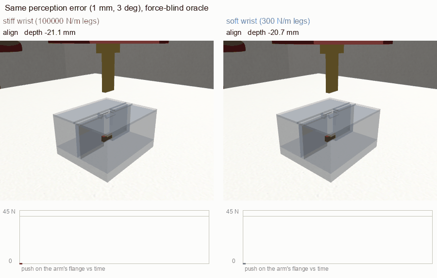
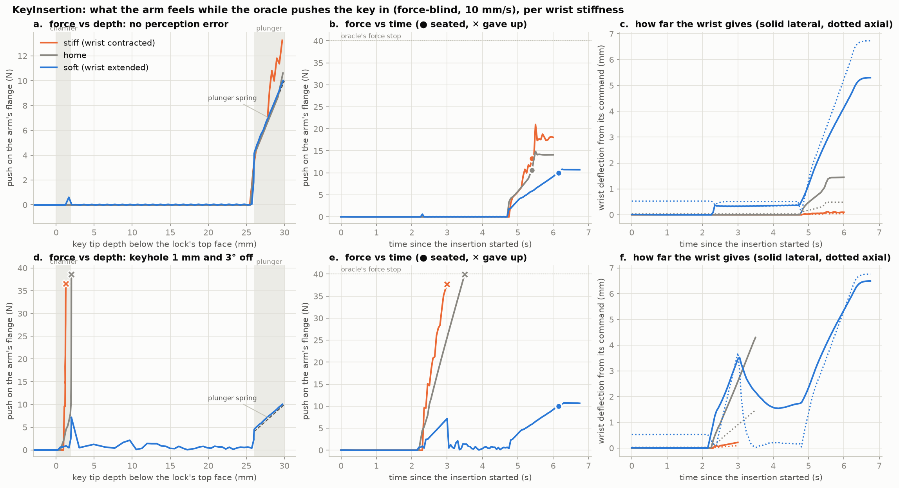
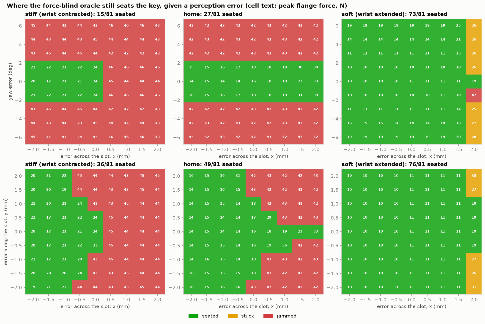
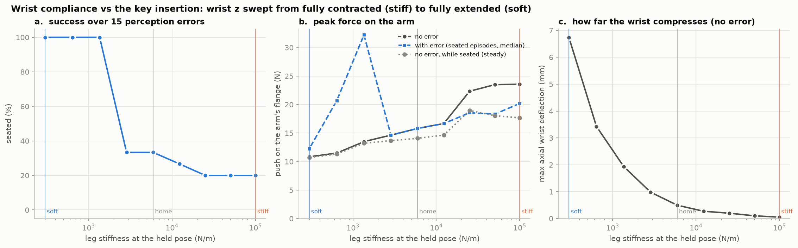
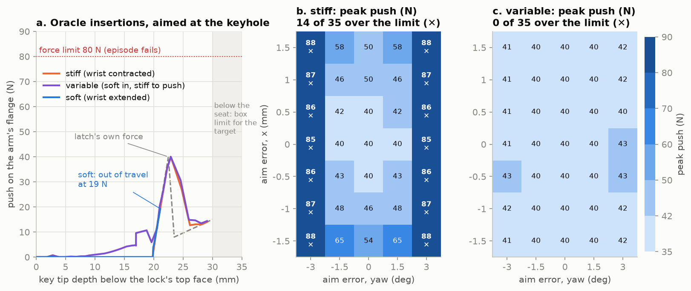
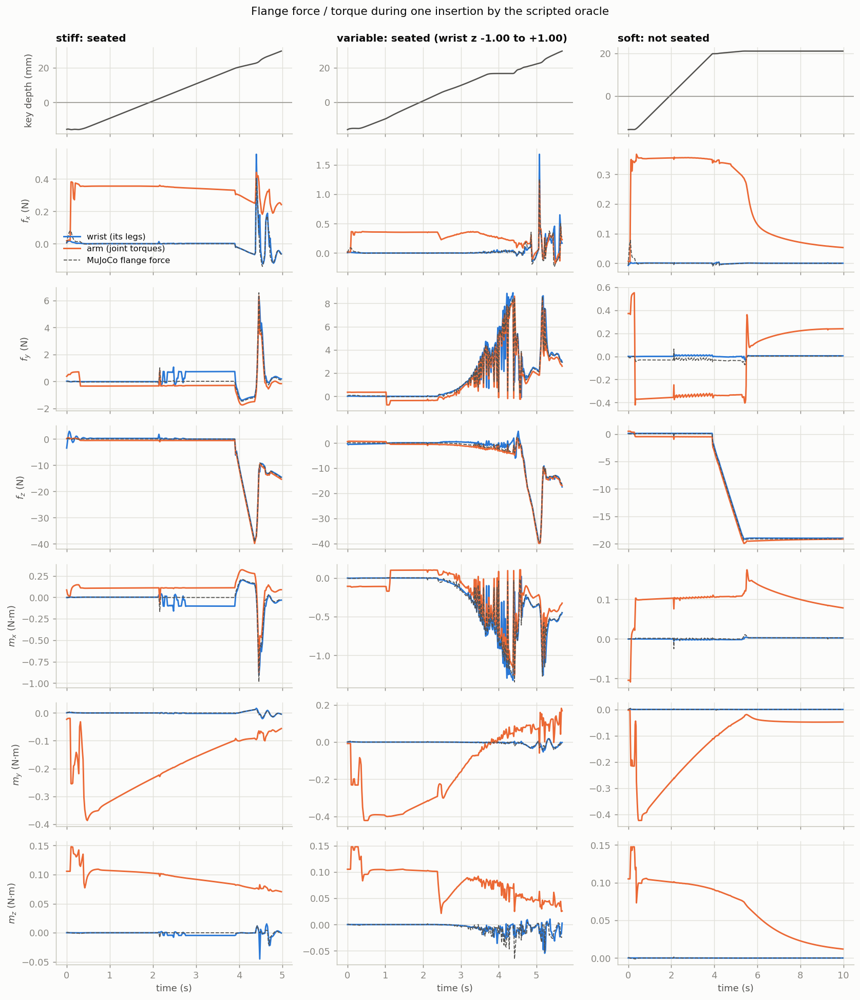
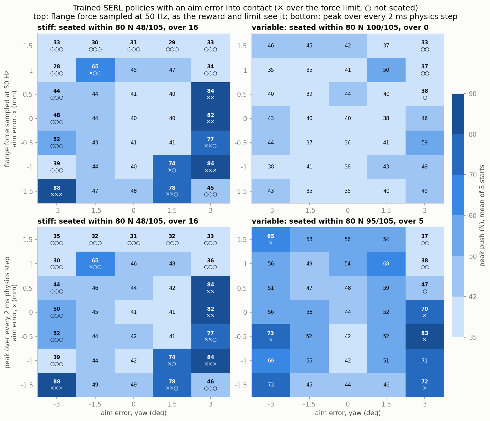
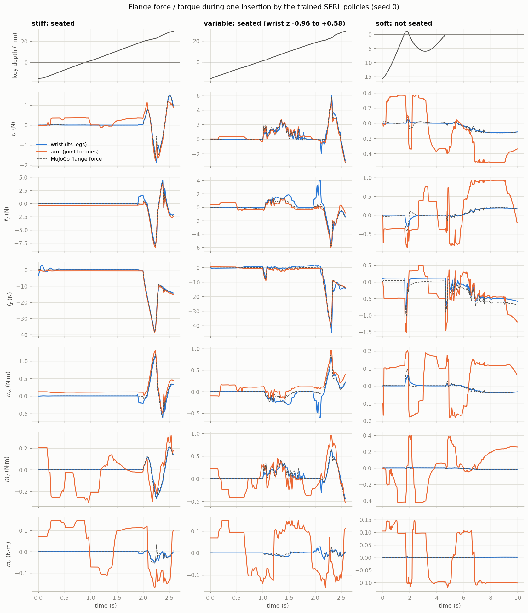

# KeyInsertion: a compliant-wrist key-in-lock task

A top-down key-in-lock (or RAM-stick-in-slot) insertion for the Panda + Stewart wrist. A rigid 10 g key replaces the
ALOHA gripper. The keyhole is a tight fit with a chamfered entrance, and seating takes a sustained push against a
spring. The setup is built so that the wrist's compliance (300 N/m to 100 kN/m legs) visibly changes whether the key
goes in and how much force the arm feels.





## The setup

| part | what it is | where |
|---|---|---|
| key | Rigid box blade, 14 x 4 x 35 mm, on an 8 mm bow, 10 g total, friction 0.4. Its tip is the `grip_site`. 0 dof, so the robot's action is 12-dim. | `KeyConfig`, `KeyTool` in `models/grippers/key_tool.py`; `StewartWristKey` in `wrist_gripper.py` |
| keyhole | Rectangular slot, blade + 0.5 mm per dimension (0.25 mm per side), 2 mm x 45° chamfer at the entrance, built from boxes. The slot's long side runs along the lock's y. | `KeyInsertion._lock_xml` |
| plunger | At the bottom of the slot (a pin tumbler / the RAM slot's latch springs): a slide joint with a preloaded spring, 4 N when the key first touches it at 26 mm deep, 10 N after 4 mm of travel, when the key is seated at 30 mm. | same |
| lock pose | Position (±5 cm in x, ±8 cm in y) and yaw (±15°) randomized on every reset, by moving the lock's fixed body in the model. It is saved in the model XML, so demos replay. | `KeyInsertion._reset_internal` |
| success | Plunger pushed ≥ 90% of its travel (only the key can reach it). | `KeyInsertion._check_success` |
| forces | `env.key_contact_wrench()`: MuJoCo's contact forces between the key and the lock (`mj_contactForce`). `flange_wrench` observation: the external wrench on the arm's flange (`WristGripperModel.flange_wrench`, `cfrc_int`). Both come from the simulator, not from a model on the side. | |

Contacts: the key and the wrist's top plate weigh about 20 g, and MuJoCo scales contact softness with the inverse of
the effective mass. With the default contact parameters the key sank 4 mm into the plunger. The lock's geoms therefore
use `solimp="0.99 0.9999 0.0002"`, `solref="0.004 1"` and `priority="1"`, which keeps penetration at about 0.1 mm. The
plunger has 50 g of armature, so its explicitly integrated spring doesn't ring at the 2 ms timestep, the same reason
the wrist's legs have armature.

## The oracle

`oracle.py` is a scripted expert that knows the lock's pose, plus whatever perception error you give it. It runs in
five phases:

1. Holds the wrist at a fixed pose: `--wrist stiff` = fully contracted (z = −1, 100 kN/m legs), `home` (6 kN/m),
   `soft` = fully extended (z = +1, 300 N/m), or any normalized z.
2. Records where the key's tip sits relative to the arm's tcp, in free space.
3. Moves the tip above the believed keyhole with a min-jerk path and aligns the blade with the slot.
4. Lowers the arm's target at 10 mm/s.
5. Stops when the key is seated (then holds 0.5 s), when the flange force passes 40 N ("jammed"), or when the target
   is 15 mm below the seated depth ("stuck").

It never uses the force to steer. The wrist is a passive spring between the arm and the key, so the task tests that
spring directly.

## What compliance does

Generated by `python -m key_insertion.evaluate` and `make_figures`. All numbers are from `results/summary.md`.



**Force while inserting (no perception error, top row).** All three wrists slide straight into the slot, and the
first force is the plunger at 26 mm deep. With the soft wrist, the push tracks the plunger's own spring (4 → 10 N): the
wrist compresses 6.7 mm, so the arm's target overshoots without the force overshooting. It also bends ~5 mm sideways under the arm's coupled push (see below), which is harmless once the blade is down the slot. The stiffer wrists pass the
target's overshoot straight to the key. At the seat the push spikes to about 23 N (stiff) and 16 N (home) against the
plunger's stop, and holding settles at 17.7 / 14.1 / 10.7 N (stiff / home / soft). With a 1 mm / 3° error (bottom
row), the stiff and home wrists wedge in the chamfer at 1–2 mm deep, and the push climbs to the oracle's 40 N stop.
The soft wrist deflects up to 3.5 mm sideways, slides down the chamfer at under 7 N, and seats.



| seated (of 81 per grid) | stiff (100 kN/m legs) | home (6 kN/m) | soft (300 N/m) |
|---|---|---|---|
| x error ±2 mm by yaw error ±6° | 15 (19%) | 27 (33%) | 73 (90%) |
| x error ±2 mm by y error ±2 mm | 36 (44%) | 49 (60%) | 76 (94%) |
| random lock poses, no error (30) | 30 (100%) | 30 (100%) | 30 (100%) |
| median push while seated | 16.6 N | 14–16 N | 10.7 N |

- Yaw is what the stiff wrists can't absorb: anything past ±1.5° jams them. The soft wrist seats every yaw error up
  to ±6°, for 11–19 N peak.
- Without a perception error, every wrist seats the key at all 30 random lock poses. The differences come from the
  error, and from how hard the arm ends up pushing (24 / 16 / 11 N median peak).
- The soft wrist's failures are all in the +2 mm column (see below).



**Sweeping the wrist from contracted to extended** (15 errors: x ±1.5 mm, yaw ±4°): success is 20–33% for legs from
100 kN/m down to ~3 kN/m, then jumps to 100% at ~1.4 kN/m and below. The step falls where the wrist becomes softer
than the arm's own ~2 kN/m impedance. The peak force with no error drops from 23.5 N to 10.8 N. At 1.4 kN/m the
median peak force over the seated error episodes (32 N) is higher than at its stiffer neighbours (~16 N). That is
selection: at 1.4 kN/m all 15 episodes seat, including the hard ones that jam (and are left out) at stiffer settings.

## The arm's own stiffness, and why the failures are lopsided

The arm runs robosuite's OSC (also what deoxys runs on real Frankas). Its Cartesian stiffness is `kp · Λ`, where Λ is
the arm's operational-space inertia, so it is neither diagonal nor the same in every direction. Measured at the key's
tip with the stiff wrist (5 N applied with `xfrc_applied`), it is about 1.6–2.3 kN/m in each axis. At the insertion pose,
Λ couples z into x (Λ_xz ≈ −16 kg): an 8 mm push down also pushes the flange about 20 N toward +x, away from the robot.
Two things follow:

- The arm is softer than the stiff and home wrists (100 kN/m and 6 kN/m legs). With those, the arm's impedance carries
  most of the compliance, and that compliance sits up in the arm, well above the key's tip. Contact on the chamfer therefore tilts and wedges
  the key instead of sliding it. Only the soft wrist (140 N/m lateral, 1.5 kN/m axial) is compliant close to the key,
  like a remote-center-compliance device.
- Errors toward +x (the key lands on the +x chamfer) fight the arm's coupled push. Errors toward −x are helped by it.
  That is why the success maps aren't symmetric. On the soft wrist, the +2 mm column fails differently: the push folds
  the wrist ~30 mm sideways and tilts the key 15–30° off the slot.

To change the arm's impedance, use `--arm-kp` (oracle) or the controller config's `kp`. A diagonal Cartesian-impedance
controller, like libfranka's example, removes the coupling: `CARTESIAN_IMPEDANCE` (`make_env(arm="impedance")`), which
the SERL task below uses. The results above are all with OSC.

## Reproduce

```bash
cd scripts
python -m pytest key_insertion/test_key_insertion.py -q
python -m key_insertion.evaluate          # results/ (~8 min on 10 cores; --quick for coarse grids)
python -m key_insertion.make_figures      # figures/*.png from results/
python -m key_insertion.render_scene      # figures/scene.png, figures/insertion.gif
mjpython -m key_insertion.oracle --wrist soft --dx 1 --dyaw 3   # watch one (plain python on Linux)
```

## Limitations

- The oracle is force-blind on purpose. A force-aware expert (spiral search, backing off when the force rises, a
  compliant wrist command) would seat the key with the stiff wrist too. Use this one to probe compliance, not as the
  best possible policy.
- The key is a plain box with no bitting, and nothing has to be turned after seating. Here the plunger is a single
  spring; the SERL task below gives it a snap latch (`latch_profile`).
- The lock is made of boxes, so the chamfer has small square pockets at its four corners (2 x 2 mm, 2 mm deep).
- One arm controller (robosuite OSC, kp 150) and one insertion speed (10 mm/s). Both change the forces.

# SERL: does a variable-stiffness wrist help?

A second version of the task, for reinforcement learning with [SERL](https://github.com/rail-berkeley/serl), built to
compare three policies: the wrist at full stiffness, at minimum stiffness, and with the wrist's z (its stiffness) as an
extra action. No human demos: a scripted oracle supplies them.



## What changes from the study above

| | above | SERL task (`KeyInsertionWrist-v0`, `serl_env.py`) |
|---|---|---|
| arm | robosuite OSC, kp 150 (~2 kN/m, x–z coupled) | `CARTESIAN_IMPEDANCE`: diagonal 20 kN/m, 300 N·m/rad (measured 20.7–21.3 kN/m, ≤ 6% cross-coupling) |
| lock | randomized pose, 4 → 10 N spring | fixed at the table's center. RAM-style latch at the slot's bottom: the plunger is met 20 mm down, its force rises to a 40 N breakaway over 2.5 mm, snaps down to 8 N, then rises to 15 N at the seat (10 mm of travel) |
| start | far from the lock | key tip 10–20 mm above the keyhole, ±5 mm in x and y, ±5° in yaw |
| control | absolute tcp pose at 20 Hz | 10 Hz, deltas of the key tip's target: ±2 mm and ±1° per step (x, y, z, yaw). Each step is spread over 5 arm / wrist updates (50 Hz) |
| limits | – | the tip target stays within ±10 mm of the keyhole's axis, ≤ 30 mm above the lock, **≤ 5 mm below the seated depth** (SERL's franka_env clips its target the same way). The episode **fails above 80 N** at the flange (2x the latch) |
| success | plunger ≥ 90% down | same (so: past the latch), without passing 80 N on the way. Ends the episode. 100 steps (10 s) |
| reward | – | 1 on success, minus a force penalty every step: 0.25·(F / 80 N)², F the step's peak flange force. Pushing the latch's 40 N costs 0.06 per step, a step at the limit 0.25 (`--force_penalty 0` for success only) |

**Why the box and the force limit:** without them the soft wrist wins everything. Under the 20 kN/m arm it just
compresses ~16 mm and pushes through any detent. With the target allowed at most 5 mm below the seat, the soft wrist
(1.5 kN/m axially) runs out of travel at ~19 N, short of the latch's 40 N. The stiff wrist has the travel, but any
misalignment wedges the key, and the force limit turns wedging into a failure.

**The three modes:** `stiff` (z = −1 throughout), `soft` (z = +1), `variable` (a 5th action: the wrist's z command,
absolute, −1 stiff … +1 soft). Because the leg stiffness follows the commanded leg length, changing z also moves the
key up to 40 mm. Two things handle that:

- **In free space the arm cancels the shift.** The tip's offset from the tcp is calibrated at both ends of z, and the
  arm's target follows it, so the key stays put to within 0.5 mm. That is tested.
- **Under load, the force stays continuous.** On every z change, the arm moves by (K_old⁻¹ − K_new⁻¹)·f, where f is
  the wrist's own F/T force (from its legs, see below; with a 1 N deadband) and K is the wrist's translational
  stiffness at the commanded pose. The
  wrist then carries the same force at its new stiffness.
  - Example: pushing 15 N into the latch soft, then stiffening fully, ends at 22 N (25 N peak during the ramp).
  - Without the compensation, the stored compression becomes a push of up to 48 N, which drives the key through the
    latch by itself.
  - The leftover +50% comes from K changing under a 9.5 mm deflection.
  - z changes at most 0.1 per step (20 mm/s of platform travel). Faster changes, under contact, bounce the key: the
    stiff platform moves at once, while the arm takes ~70 ms to follow its compensation.

**Observation** (22 values, scaled to about unit size):
- the key tip's position, orientation error and velocity in the lock frame;
- the F/T at the flange as the wrist measures it (6): its legs' spring and damper forces, from their encoders
  (`WristGripperModel.leg_wrench`), not a separate F/T sensor;
- the wrist's deflection from its commanded pose (6, as the leg encoders give it);
- the wrist's z command.

The lock is fixed and not observed. The policy learns where it is.

## The oracle (demonstrator)

`ScriptedPolicy` knows the keyhole. It lines the tip target up (x, y, yaw), descends at 10 mm/s and pushes until
seated. In variable mode it stays soft through the chamfer. Once 4 mm in, it re-aims at where the slot holds the tip
(read from the leg encoders), stiffens, and waits at 16 mm until the wrist is stiff before pushing through the latch.
Its demos have Gaussian noise (σ = 0.1) on the motion actions, not on the stiffness.

| oracle, 20 demos each | seated | median length | median peak push |
|---|---|---|---|
| stiff | 20/20 | 50 steps | 39.9 N |
| variable | 20/20 | 57 steps | 40.1 N |
| soft | 0/20 (out of travel) | 100 steps | 19.4 N |

Aimed at the keyhole, stiff and variable both seat the key at the latch's 40 N (figure, a). The difference shows when
the aim is off (b, c: 1.5 mm and 3° off, no noise):
- **Variable** seats every case at 40–43 N, the latch's own force: the soft wrist lets the chamfer line the key up.
- **Stiff** seats within ±1.5° at 40–65 N, but every ±3° case wedges and goes past 80 N.

So whether a learned stiff policy can match the variable one comes down to how precisely it learns to aim.

## Force sensing: the wrist vs the arm

Two ways to know the force at the flange without an F/T sensor, both idealized (exact models, no noise):
- **the wrist**, from its legs (`leg_wrench`): each leg's spring force kp·(command − encoder length) plus its damping,
  along the leg, summed at the flange, minus the weight the legs hold at rest. This is the policies' F/T observation.
- **the arm**, from its joint torques (`KeyInsertionSERL.arm_wrench`), as a torque-sensing arm like the Franka does:
  τ_ext = τ_model − τ_joints, with the wrist and key as a rigid payload, mapped to the flange through the Jacobian.

`make_ft_figure.py` plots both against MuJoCo's own flange force over one insertion per mode:



| oracle episode | wrist − MuJoCo, force RMS (max) | arm − MuJoCo | wrist − arm |
|---|---|---|---|
| stiff, seated, 39 N peak | 0.67 N (3.8) | 0.72 N (0.8) | 1.11 N (3.6) |
| variable, seated, 40 N peak | 1.29 N (7.6) | 0.72 N (0.9) | 1.70 N (8.0) |
| soft, not seated, 19 N peak | 0.15 N (0.3) | 0.57 N (0.7) | 0.67 N (1.0) |

Both follow the 40 N push closely. What each one misses:
- **The arm** reads 0.1–0.4 N / N·m at rest: its joints' Coulomb friction (0.1 N·m each), which no model predicts
  while the arm stands still. The offset drifts as the arm moves.
- **The wrist** misses what doesn't go through its leg springs: the inertia of the base plate and legs, and
  vibration of the leg rods against their ball joints. A contact kick sets the rods going, for errors of up to a few
  N (stiff, from 2.2 s; variable, while it changes stiffness). The rod vibration is likely a simulation artifact: the
  ball joints are soft equality constraints.
- **The springs alone are not enough.** When z changes, the leg commands move and for a moment the springs push
  ~10 N against the dampers while the flange carries ~0. So the wrist's reading includes the dampers, which it can
  compute from its encoder velocities (5.5 → 1.3 N RMS for the variable oracle).

## Numerics

- The arm controller's stiffness, the latch's force, and whole oracle episodes give the same results at the default
  2 ms timestep and at 0.5 ms (tests: peak force within 15%, episode length within 2 steps).
- The plunger's end stops use a 10 ms time constant here (`plunger_stop_timeconst`; the study above keeps 4 ms), so
  the key's impact on the seat after the snap doesn't depend on the timestep. With 4 ms it read 77 N at 2 ms and 44 N
  at 0.5 ms.
- The force limit and the force penalty use the flange force sampled at each of the 50 Hz updates, not at every
  physics step, so a peak shorter than 20 ms slips past both. `info["max_force_physics"]` has the peak over every
  physics step. This matters: with aim errors, the trained variable policy's true peaks are ~10 N above what the
  reward saw, and 5 of its 100 "successes" passed 80 N between samples (see the results).

## Running it

SERL needs its own venv (Python 3.10, JAX 0.4.35): see `requirements_serl.txt`. Everything except training also runs
in `robosuite_env`. From `scripts/`:

```bash
python -m pytest key_insertion/test_serl_env.py -q            # 14 tests, ~1 min
python -m key_insertion.collect_demos --mode all --n 20     # demos/{stiff,soft,variable}_20.pkl (run with the SERL venv's python:
                                                            #   numpy 2 pickles don't load in SERL's numpy 1.26)
bash key_insertion/launch_serl.sh variable 0 5488           # learner + actor; logs in runs/variable_seed0/
bash key_insertion/launch_serl.sh stiff 0 5498 --max_steps 50000   # concurrent runs need different ports
python -m key_insertion.make_serl_figures                   # figures/serl_oracle.png
python -m key_insertion.make_ft_figure --oracle             # figures/ft_comparison_oracle.png (SERL venv)
python -m key_insertion.make_ft_figure                      # the same for the trained policies (runs/<mode>_seed0/final)
python -m key_insertion.aim_error_eval                      # figures/aim_error_policies.png (SERL venv)
```

Each run writes `runs/<mode>_seed<seed>/eval.csv`: every `--eval_period` env steps (default 2000) and at the last one,
10 episodes of the deterministic policy (success, length, peak push, over-force rate, mean wrist z, return). At the
end the actor saves the policy to `runs/<mode>_seed<seed>/final/`. `train_serl.py` is SERL's async SAC state example with:
- the demos added RLPD-style, 50/50 in every critic minibatch;
- the actor paced at 10 Hz, as on the real robot;
- at most 0.5 learner updates (4 critic steps) per online transition.

The pacing and the cap mean that runs on different machines train on the same schedule, as long as the learner keeps
up. `learner.log` prints the ratio it reached.

## Results (seed 0, force-penalty reward, 50k env steps)

On the training starts (no aim error), from `runs/<mode>_seed0/eval.csv`, 10 episodes per evaluation:

| | first 10/10 seated | at 50k: seated, length, peak push, return |
|---|---|---|
| stiff | 10k steps | 10/10, 26 steps, 39.8 N, 0.86 |
| variable | 25k steps | 10/10, 27 steps, 36.2 N, 0.88 |
| soft | never | 0/10 (stays off the lock: the latch is out of reach, and touching costs) |

Both seat at about the latch's 40 N, the minimum any seating takes. On these starts the policy lines up before contact,
so there is no misalignment for compliance to absorb. (The binary-reward runs, kept in `runs/binary_reward_50k/`, got
to 10/10 at 20k and 35k steps, pushing 44–54 N.)

**With an aim error into contact** (`aim_error_eval.py`): each policy sees the key relative to a keyhole shifted by
(x, yaw) on the oracle's grid, 3 starts per case. Scored with the force the reward sees (50 Hz) and with the true
peak (every 2 ms):

| policy | force scored | seated within 80 N | over 80 N | not seated | median peak push, successes |
|---|---|---|---|---|---|
| stiff | 50 Hz | 48/105 | 16 | 41 | 42.7 N |
| stiff | 2 ms | 48/105 | 16 | 41 | 44.5 N |
| variable | 50 Hz | 100/105 | 0 | 5 | 40.8 N |
| variable | 2 ms | 95/105 | 5 | 5 | 53.0 N |



- **Variable is far more tolerant of aim error:** 95/105 seated within 80 N (true peak) against 48/105. It meets the
  lock partly compliant (median wrist z +0.17 at first contact) and lets the chamfer line the key up. Stiff either
  stops pushing on a wedged key and times out (41), or pushes through the limit (16, mostly at ±3° yaw).
- **It does not push less.** Its true peaks are higher than stiff's (median 53 vs 45 N): short spikes that the 50 Hz
  force the reward and limit see mostly misses.
- Within an episode it does use the stiffness (z from −0.96 to +0.58 in the F/T figure's episode), which the
  evaluations' episode-mean z (~0) hides.

The F/T readings over the trained policies' insertions (`make_ft_figure.py`) agree with the oracle's:



## Limitations

- The wrist's stiffness follows its commanded leg length, not the actual one (as the real wrist does, per its
  designer). So the soft wrist stays soft however far it is compressed.
- The force-continuity compensation is translational only. Stiffening re-imposes the commanded tilt and yaw, which
  loads the blade against the slot's walls (5–10 N in figure a, variable, 10–20 mm deep). The oracle avoids most of it by
  re-aiming first.
- One training seed so far, and 3 starts per aim-error case.
- One latch profile, one box depth (5 mm) and one force limit (80 N). Each of them moves the line between "soft wins"
  and "stiff wins".
