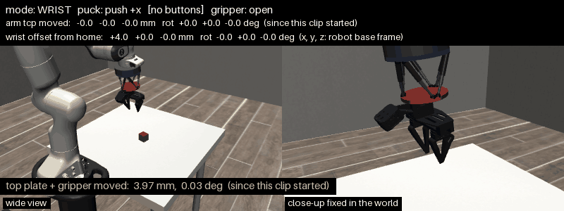
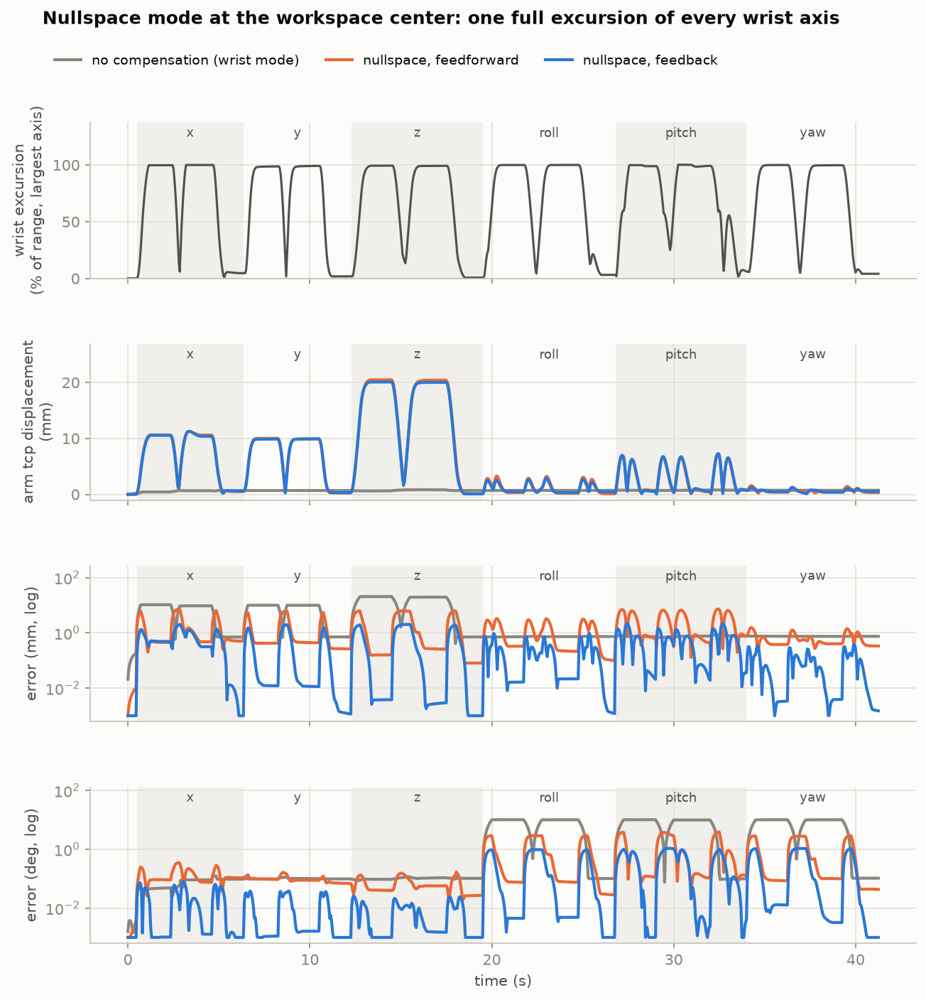
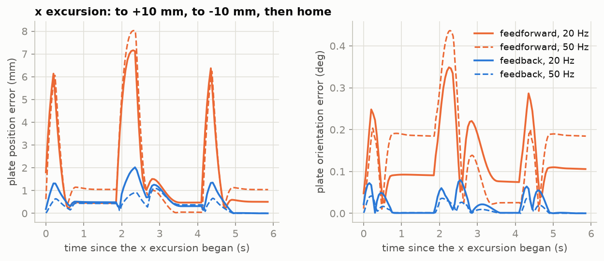
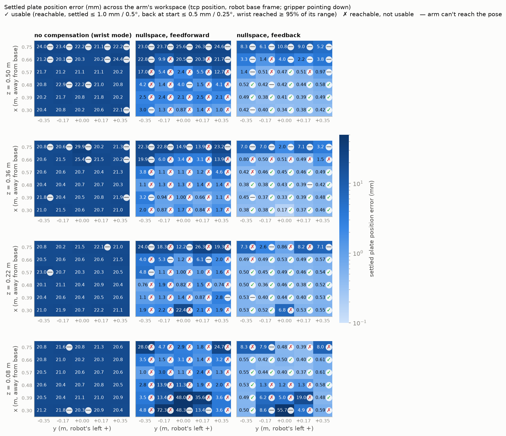
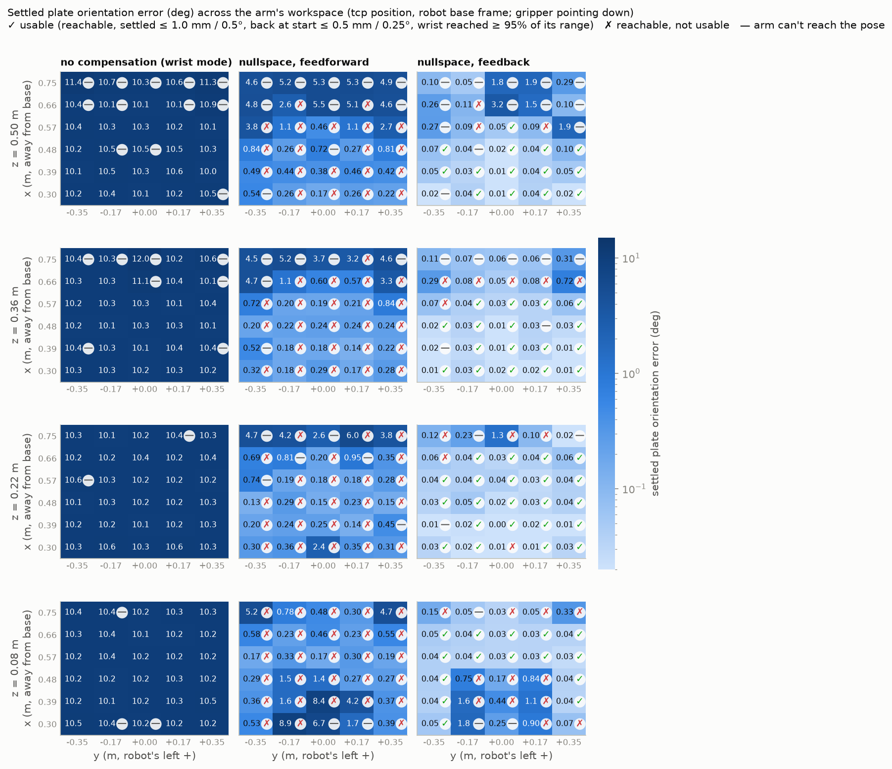
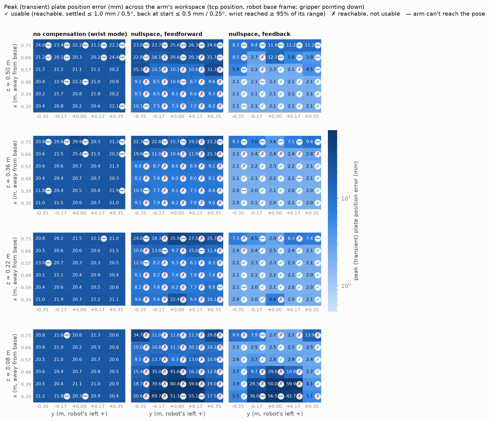
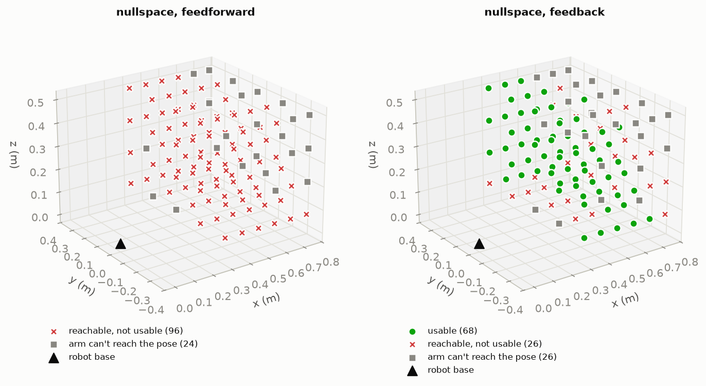
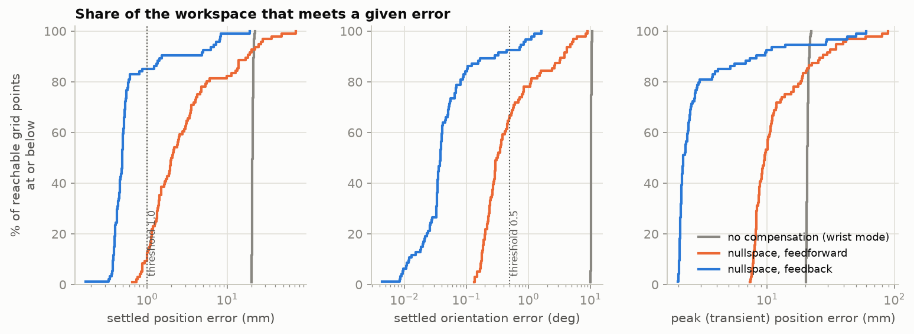
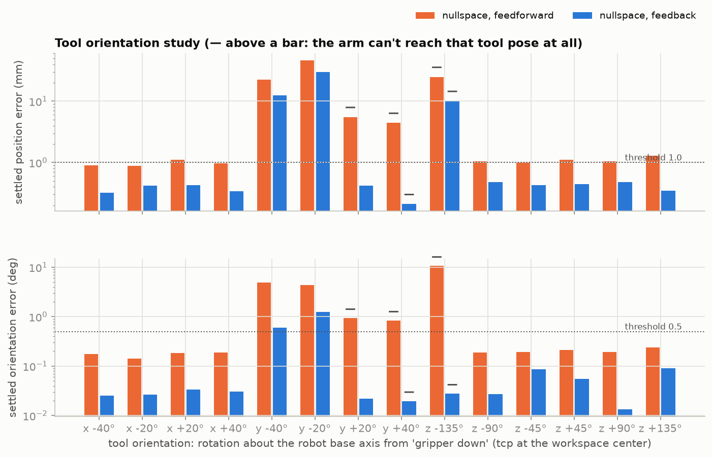
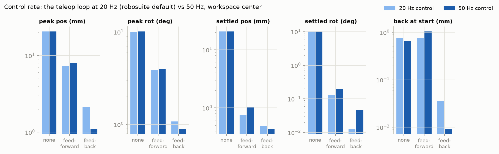

# Nullspace teleop mode

A third teleop mode for `PandaStewartAloha`. The operator drives the **wrist**, exactly as in wrist mode, while the
**arm moves the opposite way**, so the wrist's top plate and the gripper bolted to it **stay still in task space**.
The wrist reconfigures underneath a stationary tool. You might use this to re-center the wrist before a fine motion,
to change the arm's posture while holding a grasp, or to test how the wrist alone affects contact.



*The same puck input twice: in wrist mode (first half) the gripper moves with the wrist. In nullspace mode (second
half) the arm cancels the wrist, and the gripper stays within about 1 mm / 1° while moving and about 0.1 mm once the
puck is released. The right-hand view is fixed in the world.*

- [Using it](#using-it)
- [Is it possible? Redundancy](#is-it-possible-redundancy)
- [The math](#the-math)
- [Implementation](#implementation)
- [How it was evaluated](#how-it-was-evaluated)
- [Results](#results)
- [Limitations and possible improvements](#limitations-and-possible-improvements)
- [Reproducing everything](#reproducing-everything)
- [References](#references)

## Using it

```bash
cd scripts
mjpython teleop_wrist.py --env Lift --input spacemouse                                # feedback (default)
mjpython teleop_wrist.py --env Lift --input spacemouse --nullspace-comp feedforward
```

| Input | Effect |
|---|---|
| `m`, or both puck buttons together | next mode: **arm → wrist → nullspace → arm** |
| puck / keyboard motion in nullspace mode | moves the wrist, with the same speeds, button modes, frames and limits as wrist mode. The arm follows automatically. |
| `r` | re-seed the arm target on the arm, and re-anchor the held plate pose there |
| `h` | wrist target home; the arm moves to keep the gripper where it is |
| everything else | unchanged (`g` gripper, `c`/`s` recording, ...) |

The mode prints `nullspace: input drives the wrist, the arm cancels it (feedback)` when it engages. Recorded demos
mark nullspace steps with `teleop/mode = 2`. The recorded action is what was actually sent: the arm's computed tcp
target and the wrist's command. Replays (`validate_demos.py`) need nothing extra.

## Is it possible? Redundancy

Yes. In the words of Lynch & Park [1, §5.1.6]: when a robot has more joints than the six elements of a twist, "we
call the robot redundant. In this case, a desired twist 𝒱 places six constraints on the joint rates, and the
remaining n − 6 freedoms correspond to internal motions of the robot that are not evident in the motion of the
end-effector."

Treat the arm and the wrist as one chain. The Panda has 7 joints and the Stewart wrist 6 DoF, so n = 13 and there are
n − 6 = **7 internal motions** that leave the gripper still:

- **Six of them are the wrist pose.** For every wrist pose inside its workspace there is exactly one flange pose that
  puts the top plate back where it was. Nullspace mode lets the operator drive these six directly.
- **The seventh is the Panda's own elbow motion.** This is Lynch & Park's "position of your elbow" example
  [1, §5.1.6]. robosuite's operational space controller already resolves it with Khatib's null-space torque
  [2, Eq. (55)], described below.

This is the **macro/mini** structure of Khatib et al. [3]: "a 'macro' mechanism with coarse, slow, dynamic responses
… and a relatively fast and accurate 'mini' device". The Panda is the macro structure, and the wrist (whose stiff
legs settle in about 0.1 s) is the mini device. As in [3], "the idea … is to treat them as a single redundant
system". Moving the wrist while holding the gripper still is an internal motion of that combined system.

Whether this works in practice depends on whether the arm can produce the compensating flange motion: up to ±20 mm
and ±10°. Where it can, it also depends on how fast and how accurately it does so. The evaluation below measures
exactly that.

## The math

### Notation

Notation follows Lynch & Park [1] for kinematics and Khatib [2] for dynamics. Here are their conventions as this
document uses them:

| Symbol | Meaning (source) |
|---|---|
| $T_{ab}\in SE(3)$ | the configuration of frame {b} relative to frame {a}, $T=(R,p)$, with the subscript cancellation rule $T_{ab}T_{bc}=T_{ac}$ [1, Ch. 3] |
| $\mathrm{Rot}(\hat\omega,\theta)$ | rotation by θ about the unit axis $\hat\omega$ [1, Ch. 3] |
| $\mathcal V$, $[\mathcal V]$ | a twist $(\omega, v)\in\mathbb R^6$ and its matrix form in se(3). The body twist of $T_{sb}(t)$ is $[\mathcal V_b]=T_{sb}^{-1}\dot T_{sb}$ [1, Prop. 3.22]. |
| $[\mathrm{Ad}_T]$ | the adjoint representation of $T=(R,p)$: $[\mathrm{Ad}_T]=\begin{bmatrix}R&0\\ [p]R&R\end{bmatrix}$, with $\mathcal V'=[\mathrm{Ad}_T]\mathcal V \Leftrightarrow [\mathcal V']=T[\mathcal V]T^{-1}$ and $[\mathrm{Ad}_T]^{-1}=[\mathrm{Ad}_{T^{-1}}]$ [1, Def. 3.20, Eq. (3.78)] |
| $\theta\in\mathbb R^7$, $J_b(\theta)$, $J^\dagger$ | arm joint variables, the arm's body Jacobian ($\mathcal V_b = J_b(\theta)\dot\theta$), and the pseudoinverse [1, Ch. 5–6] |
| $q$, $A(q)$, $\Gamma$, $F$ | Khatib's [2] joint coordinates, $n\times n$ joint space kinetic energy matrix, joint forces, and operational forces. $q$ and $\theta$ are the same arm joints; each source's own letter is used where that source is followed. |

Frames in this robot (code names in parentheses; the code uses the same "B in A" convention, `T_A_B`):

```
 {b} robot base ──T_bt(θ)──► {t} wrist_tcp site ──T_tw──► {w} wrist base ──T_wp(χ)──► {p} top plate ──T_pg──► {g} grip site
                 arm joints θ        constant (fixed to the flange)         wrist pose χ             constant (gripper)
```

| Frame | What it is |
|---|---|
| **{b}** | The robot base: the frame the arm controller's targets are written in. It plays the role of Lynch & Park's fixed frame {s}. |
| **{t}** | `wrist_tcp`, the operational point the arm's controller tracks. It's fixed to the wrist base, which is bolted to the flange, and like HSA-UMI's `hsa_tcp` it sits where the top plate is at home. It's called {t} here because {s} means the space frame in [1]. |
| **{w}** | The wrist base body (the bottom plate) |
| **{p}** | The wrist's top plate. The gripper is rigidly attached to it, so $T_{pg}$ is constant and **holding {p} still holds the gripper still**. Everything below is written for {p}. |
| **{g}** | The grip site, between the fingerpads |

$T_{tw}$ (`T_S_W`) is a constant read off the sim once (`NullspaceCompensator.from_sim`). For this robot it's a pure
translation of 126 mm.

### The wrist's forward kinematics

The wrist pose is $\chi=(x,y,z,\alpha,\beta,\gamma)$ (`p` / `wrist_target` in the code): the top plate relative to
home, in {w}, with roll α, pitch β and yaw γ. This is the pose `StewartPlatformWrist` commands, and the same
coordinates as its six passive `wrist_top_*` joints (slide x, y, z, then hinge z, y, x):

$$
T_{wp}(\chi) = \big(\,\mathrm{Rot}(\hat z,\gamma)\,\mathrm{Rot}(\hat y,\beta)\,\mathrm{Rot}(\hat x,\alpha),\;\; h + (x,y,z)\,\big)
$$

where $h$ is the plate's home position in {w} (`StewartPlatformWrist.home_pos`). `test_plate_model_matches_sim`
checks this against MuJoCo to 1e-9 m / rad at random poses. By subscript cancellation, the plate's configuration in
the base frame is

$$ T_{bp} = T_{bt}(\theta)\;T_{tw}\;T_{wp}(\chi) $$

### The internal motion at the velocity level

Differentiating $T_{bp}$ and using $[\mathcal V'] = T[\mathcal V]T^{-1}$ [1, Def. 3.20], the plate's body twist is

$$
\mathcal V_p \;=\; [\mathrm{Ad}_{T_{pt}}]\,J_b(\theta)\,\dot\theta \;+\; J_\chi(\chi)\,\dot\chi
\;=\; \underbrace{\begin{bmatrix}[\mathrm{Ad}_{T_{pt}}]\,J_b(\theta) & J_\chi(\chi)\end{bmatrix}}_{J_c(\theta,\chi)\;\in\;\mathbb R^{6\times 13}}
\begin{bmatrix}\dot\theta\\ \dot\chi\end{bmatrix}
$$

where:
- $T_{pt} = (T_{tw}T_{wp})^{-1}$;
- $J_b(\theta)\dot\theta$ is the body twist of {t}, so $[\mathrm{Ad}_{T_{pt}}]$ re-expresses it at the plate;
- $J_\chi(\chi)\dot\chi$ is the body twist of {p} relative to {w}, which $T_{wp}^{-1}\dot T_{wp}$ gives.

Holding the gripper still means $\mathcal V_p = 0$, i.e. $(\dot\theta,\dot\chi)\in\mathrm{Null}(J_c)$, which is the
7-dimensional set of internal motions above.

For an operator-chosen wrist rate $\dot\chi$, the arm must produce the twist at {t} that cancels it:

$$
J_b(\theta)\,\dot\theta \;=\; \mathcal V_d \;\equiv\; -[\mathrm{Ad}_{T_{tp}}]\,J_\chi(\chi)\,\dot\chi
\qquad\big(\text{using } [\mathrm{Ad}_{T_{pt}}]^{-1}=[\mathrm{Ad}_{T_{tp}}]\big)
$$

That is Lynch & Park's inverse velocity kinematics problem $J\dot\theta=\mathcal V_d$. Its solution
$\dot\theta = J_b^\dagger(\theta)\mathcal V_d$ [1, Eq. (6.7)] "returns joint velocities $\dot\theta$ minimizing the
two-norm" [1, §6.3]. Adding any $(I-J_b^\dagger J_b)\dot\theta_0$ moves only the arm's own 1-D internal motion (the
elbow). That is the classical null-space form of redundancy resolution, surveyed by Siciliano [4]. Nakamura et al. [5]
extend it to a hierarchy of prioritized tasks.

### Why the position level: the feedforward arm target

Lynch & Park warn that when velocity-level solutions are integrated, "small velocity errors are likely to accumulate
over time, resulting in increasing position error" [1, §6.3]. They also note that "numerical methods for calculating
inverse kinematics for redundant robots, at either the configuration or velocity levels, are likely to yield motions
that are not closed loops in the joint space" [1, §6.4]. So this controller never integrates the equation above. It
enforces the same constraint exactly, at the configuration level.

When nullspace mode engages, it **anchors** the plate configuration $T_{bp}^0$ (`T_B_P0`). Every tick, the operator's
input moves the wrist target $\chi^*$ (integrated exactly as in wrist mode). Solving $T_{bp}=T_{bp}^0$ by subscript
cancellation gives the arm's operational-space target:

$$ \boxed{\,T_{bt}^{*}(\chi^*) \;=\; T_{bp}^{0}\;T_{wp}(\chi^*)^{-1}\;T_{tw}^{-1}\,} $$

(`NullspaceCompensator.arm_target`). This is the configuration-level integral of the velocity relation:
differentiating it reproduces $\mathcal V_d$ above. It is a function of $\chi^*$ alone, so whenever the wrist returns
to a pose, the flange target returns to exactly the same configuration: a closed wrist trajectory gives a closed loop
of {t} in task space. That addresses the drift warning. Lynch & Park's joint-space caveat still applies to the one
internal DoF the formula doesn't fix, the elbow. OSC's posture term [2, Eq. (55); below] pulls the elbow back toward
the same posture, so in practice it returns as well; the evaluation's back-at-start error measures the result. The script sends $T_{bt}^*$ to the arm's controller as an absolute target and $\chi^*$ to the wrist.
This is **feedforward**: if both reach their targets, the plate is exactly on the anchor.

### How the arm executes it: Khatib's operational space formulation

robosuite's OSC controller (`controllers/parts/arm/osc.py`) cites and implements Khatib [2] for the arm alone. The
operational point is {t}, with m = 6 operational coordinates and n = 7 joints. In [2]'s notation, the joint space
equations of motion are $A(q)\ddot q + b(q,\dot q) + g(q) = \Gamma$ [2, Eq. (17)]. For a redundant manipulator,
Khatib defines the pseudo-kinetic energy matrix and the generalized inverse [2, §VI]:

$$
\Lambda_r(q) = \big[J(q)A^{-1}(q)J^T(q)\big]^{-1}, \qquad \bar J(q) = A^{-1}(q)J^T(q)\Lambda_r(q)
\qquad [2,\ \text{Eqs. (51), (52)}]
$$

$\bar J$ "is actually a generalized inverse of the Jacobian matrix corresponding to the solution that minimizes the
manipulator's instantaneous kinetic energy" [2]. Khatib's lemma is that the end-effector feels only the operational
force $F$ if and only if the joint forces are

$$ \Gamma = J^T(q)F + \big[I_n - J^T(q)\bar J^T(q)\big]\Gamma_0 \qquad [2,\ \text{Eq. (55)}] $$

where "joint forces of the form $[I_n - J^T(q)\bar J^T(q)]\Gamma_0$ correspond in fact to a null operational force
vector" [2]. Later work calls $\bar J$ the *dynamically consistent generalized inverse* [3].

robosuite computes exactly these quantities in `utils/control_utils.opspace_matrices`:
- `lambda_full` $=\Lambda_r$;
- `Jbar` $=\bar J$;
- `nullspace_matrix` $=I-\bar J J$, whose transpose is Khatib's $I_n-J^T\bar J^T$.

Its `nullspace_torques` supplies $\Gamma_0 = A(q)\,[k_p(q_{\text{init}}-q) - k_v\dot q]$, a posture term that pulls the
elbow toward its configuration at scene reset. So within each control step:
- $F$ drives {t} to $T_{bt}^*$ (the six constrained directions);
- $\Gamma_0$, projected through Eq. (55), settles the arm's one remaining internal motion without disturbing {t}.

**The relation to Khatib et al.'s macro/mini coordination [3].** In [3], the whole macro/mini system is
torque-controlled through one decomposition of the form of Eq. (55) [3, Eqs. (4)–(5)]. Their coordination strategy
uses null-space joint forces for "minimization of deviation from the midrange joint positions of the
mini-manipulator" [3, Eqs. (8)–(10)].

Here the mini device (the wrist) is position-controlled by its own leg actuators. It can't join the arm's torque-level
decomposition. The combined internal motion is therefore imposed at the configuration level: $\chi^*$ is the
internal-motion coordinate, and the boxed equation hands the macro structure the operational target that keeps
$J_c[\dot\theta;\dot\chi]=0$. Each structure then tracks its own target with its own controller. Pressing `h` in
nullspace mode is [3]'s coordination objective, applied as a direct command: the mini device returns to mid-range,
and the macro structure absorbs the motion.

### Why feedforward alone leaves a transient

Feedforward is exact only in steady state. The two structures respond at different speeds, which is what [3] means
by "coarse, slow" versus "fast and accurate":

- **The wrist** (stiff position-controlled legs) reaches a step command in about 0.1 s.
- **The arm** (OSC, kp = 150, critically damped) takes about 0.3 s for small moves and longer for big ones. It also
  stops about 0.4 mm short, held by the Panda's joint friction (0.1 N·m per joint).

While the arm lags, its tracking error $E = (T_{bt}^*)^{-1}\,T_{bt}$ passes straight through to the plate:

$$ T_{bp} = T_{bp}^0\;T_{wp}(\chi^*)^{-1}\,T_{tw}^{-1}\;E\;T_{tw}\,T_{wp}(\chi^*) $$

That is the 7 mm / 4° peak in the feedforward results.

### Feedback: the mini device cancels the macro structure's lag

Because the wrist is the fast, accurate mini device, it can absorb the arm's error. Each tick, instead of sending the
wrist $\chi^*$, send the wrist configuration that puts the plate on the anchor **given where the arm actually is**
(its measured $\hat T_{bt}$):

$$ \boxed{\,T_{wp}(\chi_{fb}) \;=\; T_{tw}^{-1}\;\hat T_{bt}^{-1}\;T_{bp}^{0}\,}, \qquad \chi_{fb} \leftarrow \mathrm{clip}(\chi_{fb},\ \pm\text{wrist limits}) $$

(`NullspaceCompensator.wrist_command`). The translation minus $h$ gives $(x,y,z)$, and the Z-Y-X angles of the
rotation give $(\alpha,\beta,\gamma)$. The arm still gets the feedforward target from $\chi^*$. As the arm converges,
$\hat T_{bt}\to T^*_{bt}(\chi^*)$ and $\chi_{fb}\to\chi^*$, so the wrist ends where the operator put it
(`test_feedback_inverts_feedforward`).

The plate error is now set by the wrist's tracking and the 50 ms command update, not by the arm. Feedback also
cancels the arm's friction-limited steady-state error, which feedforward can't. This is the benefit [3] attributes to
macro/mini systems: "the dynamic performance of a combined macro/mini system can be made comparable to … that of the
lightweight mini manipulator". The same architecture, a small fast manipulator carried by a large slow one, is the
subject of Sharon, Hogan & Hardt [6].

**The anchor.** With feedback, the anchor uses the *measured* $\hat T_{bt}$ (and the wrist's current command), so
the plate is held exactly where it was when the mode engaged; the arm's 0.4 mm steady-state offset is absorbed too.
Feedforward can't absorb it, so it anchors on the commanded $T_{bt}$, which avoids a jump when it engages.

**Stability.** Feedback adds no new loop. The arm's target depends only on $\chi^*$ and the anchor, never on
$\chi_{fb}$, and $\chi_{fb}$ is a static function of the measured arm configuration. So the wrist follows the arm, and
nothing feeds back into the arm. The only coupling is mechanical (the wrist's reaction forces on the flange), and the
evaluation found no oscillation anywhere in the workspace.

**When the mini device runs out of range.** $\chi_{fb}$ is clipped to the wrist's workspace. At a limit, the wrist
can't absorb an arm error that would push it further. The plate then shows that part of the arm's error, which is why
the "settled" errors below are measured *at* the wrist limits, the worst case. This is [3]'s motivation for keeping
the mini device near mid-range.

## Implementation

| File | What |
|---|---|
| `nullspace/controller.py` | `NullspaceCompensator`: the frame algebra above. `anchor()`, `arm_target()` (feedforward), `wrist_command()` (feedback), plus the 4×4 helpers. No robosuite dependency except `from_sim()`. |
| `teleop_wrist.py` | Mode `NULLSPACE = 2` in the cycle, `anchor_nullspace()`, the per-tick block in `tick()`, and `--nullspace-comp {feedback,feedforward}` |
| `nullspace/test_nullspace.py` | Identities (the plate stays on the anchor for any wrist pose, feedback inverts feedforward and cancels small arm errors, clipping), the plate model against the sim, the mode cycle, and a closed-loop test for both strategies |
| `nullspace/evaluate.py` | The workspace study (below) |
| `nullspace/make_figures.py` | Figures and `results/summary.md` |
| `nullspace/make_demo_gif.py` | `figures/nullspace_demo.gif` |

Per tick in nullspace mode (`Teleop.tick`):

1. The input moves the wrist target χ\* (`wrist_target`), through the same `integrate_wrist_target` as wrist mode (robot-frame
   velocities, button modes, wrist limits).
2. Arm target $T_{bt}^*$ = `arm_target(χ*)`, clipped to the teleop workspace box.
3. If the arm is more than 15 cm from its target, re-seed and re-anchor, as in arm mode.
4. Wrist command: χ_fb = `wrist_command(measured tcp)` (feedback) or χ\* (feedforward).
5. Send [$T_{bt}^*$ as pos + rotvec, wrist command (normalized), gripper] to the env.

Leaving nullspace mode (to arm mode) keeps the arm target and the wrist target where they are.

## How it was evaluated

`python -m nullspace.evaluate` drives the **real teleop loop** with a simulated SpaceMouse. Raw puck readings go
through HSA's axis map and button logic, as with the real device; nothing is called directly. Each test case:

1. Resets the Lift scene and moves the cube off the table (so nothing is touched).
2. Drives the arm in arm mode to the test pose at 0.25 m/s and waits until it stops (up to 6 s). If it ends more than
   2 mm / 1° from the pose, the pose is marked **unreachable**: the arm itself can't get there with the gripper in that
   orientation (joint limits).
3. Switches mode: **none** = wrist mode (the arm holds still: the baseline, showing what the wrist alone does to the
   gripper), **feedforward** or **feedback** = nullspace mode.
4. Runs the excursion. For each wrist axis x, y, z, roll, pitch, yaw, along the robot-frame direction an operator
   would push:
   - push **past the +limit** (1.5× the time it takes to reach it), so the wrist saturates at its limit, or at a corner
     of its range when the tool is rotated; hold 1.5 s;
   - push **past the −limit**, hold;
   - push back toward 0, press **`h`** (wrist home), hold.

   That's the full ±10 mm / ±20 mm / ±10° range at the teleop's wrist speeds (0.04 m/s, 0.35 rad/s), 18 holds and 6
   returns home per case, about 40 s of teleop.
5. Tracks the top plate's pose against its pose when the mode engaged.

**Metrics** (per case):

| Metric | Definition |
|---|---|
| peak error | the largest plate position / orientation error at any tick (the transient) |
| settled error | the largest error at the end of the 18 holds, including holds with the wrist pinned at a limit |
| back-at-start error | the largest error after the 6 homings (wrist home, everything settled): does the gripper end up in the same spot? |
| wrist range reached | the smallest fraction of its ± range that any wrist axis actually reached. This checks the wrist really moved, rather than the error staying small because nothing happened. |
| min joint margin | the closest any arm joint came to its limit |

**What counts as usable**, matching the requirement that the gripper may wander during a move but must end up where
it started:

- reachable,
- settled error ≤ **1.0 mm and 0.5°**,
- back-at-start error ≤ **0.5 mm and 0.25°**,
- the wrist reached ≥ **95 %** of its range on every axis.

Peak (transient) error is reported but not part of the criterion.

**The test set:**

- **Workspace grid:** 120 tool positions (tcp in the robot base frame, gripper pointing down): x ∈ {0.30 … 0.75} m (6
  values), y ∈ {−0.35 … +0.35} m (5), z ∈ {0.08, 0.22, 0.36, 0.50} m (4). This covers the teleop's workspace box,
  inset 5 cm from its x/y faces so the box's safety clip doesn't interfere.
- **Orientation study:** at the workspace center (0.48, 0, 0.22), the tool rotated ±20° and ±40° about the base x and
  y axes, and ±45°, ±90°, ±135° about z.
- **Control rate:** the center point at 20 Hz (robosuite's default, what the teleop uses) and 50 Hz.

Every case runs once per strategy: 408 runs in total.

## Results

Full numbers: [`results/summary.md`](results/summary.md). Raw per-case data: [`results/cases.csv`](results/cases.csv).

### Headline

| | no compensation (wrist mode) | nullspace, feedforward | **nullspace, feedback** (default) |
|---|---|---|---|
| usable workspace (of the reachable grid points) | 0 % | 0 % | **72 %** (68 of 94) |
| settled plate error, median | 20.7 mm / 10.2° | 2.0 mm / 0.31° | **0.49 mm / 0.04°** |
| peak (transient) plate error, median | 20.7 mm / 10.3° | 9.6 mm / 4.2° | **2.2 mm / 1.2°** |
| back at start, workspace center | (the gripper simply moved) | 0.75 mm | **0.04 mm** |

Without compensation the gripper moves by the wrist's full range, as expected. Feedforward cuts that by about 10×
once settled, but it can't remove the arm's own steady-state error, so it never gets back within 0.5 mm of where it
started. **Feedback holds the gripper to about half a millimetre in most of the workspace, and returns it to within
hundredths of a millimetre.** The transient is about 2 mm / 1° during a full-speed wrist move, and the gripper always
comes back.

### One run, second by second



*At the workspace center, at 20 Hz:*
- *Top: the operator saturates each wrist axis in turn.*
- *Second: the arm's tcp moves the opposite way in both nullspace modes (up to 20 mm for z) and holds still in wrist
  mode.*
- *Bottom two (log scale): the plate's error. Wrist mode (gray) moves the full range. Feedforward (orange) spikes to
  6–8 mm / 3–4° while the arm catches up, then sits at 0.2–1 mm. Feedback (blue) spikes to about 2 mm / 1° and decays
  to 0.001–0.5 mm. The remaining ~0.5 mm appears only while the wrist is pinned at a limit; see Limitations.*



*Zoom on the x excursion, at 20 Hz and 50 Hz. Feedforward's transient is the arm's lag, so a faster loop doesn't help
it. Feedback's transient is mostly the one-tick delay before the wrist hears about the arm's error, so 50 Hz halves it
(2.2 → 1.1 mm).*

### Across the workspace



*The settled plate position error at each of the 120 grid points, one row per height. Each panel is x (away from the
base) against y. ✓ = usable, ✗ = reachable but not usable, — = the arm can't reach that tool pose at all (it ends
more than 2 mm / 1° away; it's at its joint limits).*

The orientation-error and peak-error maps have the same layout:







*The same classification in 3D. Feedback is usable through the middle of the workspace:*
- *at z = 0.22 m, nearly everything from x = 0.30 to 0.66 m;*
- *at 0.36 m, x = 0.30–0.57 m;*
- *at 0.50 m, x = 0.30–0.48 m;*
- *at the lowest layer (0.08 m), x = 0.57–0.66 m, plus the outer columns (|y| = 0.35 m) closer in.*

**Where feedback fails, and why** (26 reachable points, sometimes for several reasons):

| Region | What happens | Why |
|---|---|---|
| **Far reach**, x = 0.75 m (and x = 0.66 m at z = 0.50 m) | Settled errors up to 8 mm. The wrist doesn't reach its full range. | The arm is at or near its joint limits. 8 of the 26 failures touched a joint limit during the excursion. The arm can't move the flange the extra 10–20 mm the wrist needs. |
| **Low and close**, z = 0.08 m, x ≤ 0.48 m, \|y\| ≤ 0.175 m | Transient peaks of 10–60 mm during the pitch and roll excursions, settling to 1.2–19 mm | The elbow is nearly fully folded (joint 4 ≈ −146°), and the arm Jacobian's smallest singular value falls from 0.17 to 0.07: nearly singular. OSC loses its own target by up to 40 mm for a moment. No contact or torque saturation was involved. |
| A few edge points at 0.55–0.61 mm settled | Just over the 0.5 / 1.0 thresholds | The wrist is pinned at a limit, so the arm's ~0.5 mm friction-limited static error shows through. |

When the arm can't follow, feedback keeps the **gripper** on the anchor by *not* moving the wrist as far as the
operator asked. The command is clipped to wherever the arm actually is. That is why "wrist range reached" fails at
those points: the gripper stays protected, but the operator's wrist motion isn't fully executed there.



*Cumulative distributions over the reachable grid. 85% of points settle within 1 mm with feedback, against 11% with
feedforward. 93% stay within 0.5° with feedback, against 67% with feedforward. Feedback's peak is under 3 mm at 81%
of points; feedforward's never is.*

### Tool orientation



*At the workspace center, the tool tilted about each robot axis. Feedback is usable at x ±20° and ±40°, y +20°, and z
±45°, ±90° and +135°: 10 of 14. At y −20° and −40° (the tool tilted back toward the base) the arm runs into a joint
limit compensating the wrist (its margin reaches 0), so the gripper moves 13–30 mm. At y +40° and z −135° the arm can't reach
the pose at all (—).*

### Control rate



*The workspace center at 20 Hz and 50 Hz. Feedback improves at 50 Hz: peak 2.2 → 1.1 mm, back at start 0.036 →
0.009 mm. Feedforward doesn't, because it's limited by the arm's bandwidth, not the loop rate. The teleop defaults to
20 Hz (robosuite's usual rate, and what recorded demos use); pass `--control-freq 50` for a tighter nullspace mode.*

## Limitations and possible improvements

1. **The arm defines the usable region.** Nullspace mode is only as good as the arm's ability to move the flange
   10–20 mm and 10° around the tool. Near the Panda's joint limits (far reach, high far points, tool tilted back) and
   near its folded-elbow singularity (low and close to the base), it can't. Two ways to grow the region:
   - Give OSC a null-space posture suited to the region. robosuite pulls the elbow toward the posture at scene
     reset, which can sit far from where the arm needs to be.
   - Replace OSC with an IK-based controller that uses all 7 joints with joint-limit avoidance.
2. **Settled error at the wrist's limits.** Feedback cancels the arm's error only while the wrist has room to move.
   Holding the wrist at a limit leaves the arm's ~0.4–0.5 mm static error (joint friction) visible. A simple fix is to
   cap the operator's wrist target at, say, 90% of the range in nullspace mode, which keeps a margin for compensation.
   Another is a slow integral term on the arm target, which removes OSC's static error itself; it adds a feedback loop
   on the arm, so it needs a stability check.
3. **The transient.** Feedback's ~2 mm / 1° peak is the one-tick delay at 20 Hz (it halves at 50 Hz) plus the
   wrist's own response time. Smoothing the operator's wrist input, or rate-limiting it to what the arm can follow,
   would shrink it further at the cost of a softer feel.
4. **The workspace box.** In nullspace mode the arm target is still clipped to the teleop's safety box. Within about
   2 cm of a box face, the clip overrides the compensation and the gripper moves. The evaluation grid stays 5 cm
   inside the x/y faces to measure the controller rather than the box.
5. **Simulation vs hardware.** The kinematic model here is exact (it is the simulator's own model, checked to 1e-9).
   On hardware, $T_{tw}$, $h$ and the wrist's pose estimate would come from calibration, and their errors would show
   up directly as plate motion. Feedback also needs a measured flange pose at the control rate, which a Franka
   provides (its joint encoders, through forward kinematics).
6. **No contact model in the evaluation.** The cube is moved off the table and nothing is touched. When the gripper
   is pushing on something, the plate won't stay exactly still. It will comply according to the wrist's stiffness
   (`platform_stiffness`, which depends on the wrist pose). That interaction isn't characterized here.

## Reproducing everything

```bash
cd /Users/jamesavtges/robosuite_wrist/scripts && source ../robosuite_env/bin/activate
python -m pytest nullspace/test_nullspace.py -q     # 7 tests, ~10 s
python -m nullspace.evaluate                        # 408 runs, ~10 min on 10 cores -> results/cases.csv, timeseries_*.npz
python -m nullspace.make_figures                    # -> figures/*.png, results/summary.md
python -m nullspace.make_demo_gif                   # -> figures/nullspace_demo.gif
```

`python -m nullspace.evaluate --quick` runs 30 cases in about a minute.

## References

Sources marked † were read for this document, and the quotes and equation numbers above come from them. The others
are cited from their abstracts and bibliographic records, for the general method they introduced or surveyed.

1. † K. M. Lynch and F. C. Park, *Modern Robotics: Mechanics, Planning, and Control*. Cambridge University Press,
   2017. Quotes and numbering are from the Dec 2019 preprint of the updated first edition,
   [modernrobotics.org](http://modernrobotics.org). Used: Ch. 3 (Def. 3.20, Eq. (3.78), Prop. 3.22), §5.1.6, §5.2,
   §6.3 (Eq. (6.7)), §6.4.
2. † O. Khatib, "A unified approach for motion and force control of robot manipulators: The operational space
   formulation," *IEEE Journal of Robotics and Automation*, vol. RA-3, no. 1, pp. 43–53, Feb. 1987,
   [doi:10.1109/JRA.1987.1087068](https://doi.org/10.1109/JRA.1987.1087068).
   [PDF](http://khatib.stanford.edu/publications/pdfs/Khatib_1987_RA.pdf); this is the reference robosuite's
   `osc.py` cites. Used: Eq. (17); §VI "Redundant Manipulators", Eqs. (51), (52), (55).
3. † O. Khatib, K. Yokoi, K. Chang, D. Ruspini, R. Holmberg, and A. Casal, "Decentralized cooperation between
   multiple manipulators," in *Proc. IEEE International Workshop on Robot and Human Communication (RO-MAN)*, 1996,
   pp. 183–188. [PDF](https://ai.stanford.edu/manips/publications/pdfs/Khatib_1996.pdf). Used: §2.2–2.4,
   Eqs. (4), (5), (8)–(10).
4. B. Siciliano, "Kinematic control of redundant robot manipulators: A tutorial," *Journal of Intelligent and Robotic
   Systems*, vol. 3, pp. 201–212, 1990, [doi:10.1007/BF00126069](https://doi.org/10.1007/BF00126069).
   A survey of Jacobian-based, null-space and task-priority redundancy resolution.
5. Y. Nakamura, H. Hanafusa, and T. Yoshikawa, "Task-priority based redundancy control of robot manipulators,"
   *The International Journal of Robotics Research*, vol. 6, no. 2, pp. 3–15, 1987,
   [doi:10.1177/027836498700600201](https://doi.org/10.1177/027836498700600201). Lower-priority subtasks executed in
   the redundancy left by higher-priority ones, via Jacobian pseudoinverses.
6. A. Sharon, N. Hogan, and D. E. Hardt, "The macro/micro manipulator: An improved architecture for robot control,"
   *Robotics and Computer-Integrated Manufacturing*, vol. 10, no. 3, pp. 209–222, 1993. The volume and pages are as
   cited by later work; the paper is based on A. Sharon's Ph.D. thesis of the same title, MIT, 1989
   ([DSpace](https://dspace.mit.edu/handle/1721.1/14434)).
